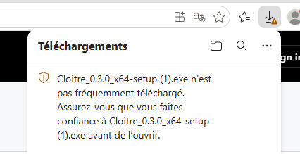
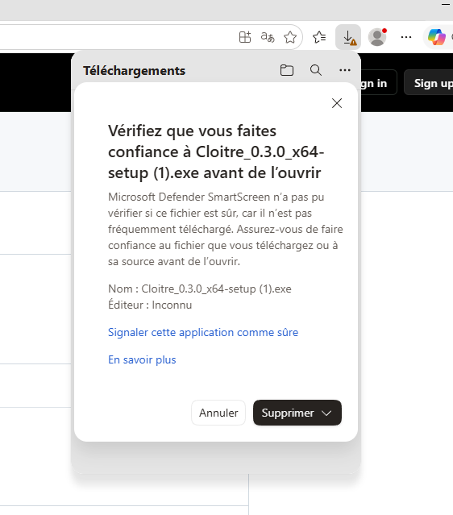

# Cloître

A desktop terminal that runs only [Claude Code](https://claude.com/claude-code). One project per folder, as many tabs as you want per project, and every tab starts in the project's folder.

Built with Tauri, TypeScript and xterm.js. Windows first, macOS next.

**Status:** early stage. Windows only for now.

Cloître is an independent project, not affiliated with or endorsed by Anthropic.

## Install on Windows

1. Download `Cloitre_<version>_x64-setup.exe` from the [latest release](https://github.com/AxiaCoder/cloitre/releases/latest).
2. Optionally, [check the download](#check-the-download).
3. Run it. It installs for your Windows account only, in `%LOCALAPPDATA%\Cloitre`, and asks for no administrator rights. It adds Cloitre to the Start menu and the desktop.

The installed app then offers each new release itself.

### The "isn't commonly downloaded" warning

The installer is not signed with a code signing certificate, so Microsoft Defender SmartScreen does not know its publisher. In Microsoft Edge, it holds the download:

1. The downloads panel says the installer **isn't commonly downloaded**.

   

2. Point at the download, click **…**, then **Keep**.
3. A window asks you to make sure you trust the file, with `Publisher: Unknown`. Open the arrow next to **Delete** and choose **Keep anyway**.

   

Once the download is kept, the installer runs without a further warning. With another browser, Windows may stop the installer when it starts instead, with a blue **Windows protected your PC** window: click **More info**, then **Run anyway**.

The warning comes from the missing signature, not from something found in the file. Each release's notes give the result of a Microsoft Defender scan of its installer, and you can check that your download is the file that was scanned.

### Check the download

Each release carries `SHA256SUMS.txt`, the SHA-256 checksum of each of its files. In PowerShell, in the folder you downloaded the installer to:

```powershell
(Get-FileHash .\Cloitre_<version>_x64-setup.exe -Algorithm SHA256).Hash
```

The result must match the line of `SHA256SUMS.txt` for that file (PowerShell prints it in upper case, the file in lower case). If both files are in the same folder, on Linux or macOS: `sha256sum -c SHA256SUMS.txt --ignore-missing`.

### Uninstall

Settings, Apps, Installed apps, Cloitre, Uninstall. The uninstaller shows a **Delete the application data** box, unticked by default:

- unticked, your projects, tabs and settings stay in the [data folder](#data-folder) and come back if you reinstall;
- ticked, the data folder is deleted too.

## Data folder

Each build keeps its project list, tabs and session ids in its own folder, so a development build can run beside the installed app without touching its data:

| Build | Data folder on Windows |
|---|---|
| Release (installed app) | `%APPDATA%\com.cloitre.desktop` |
| Development (`pnpm tauri dev`, `pnpm tauri build --debug`) | `%APPDATA%\com.cloitre.desktop.dev` |

A development build shows `(dev)` after its window title. Run the executable `pnpm tauri build --debug` leaves in `src-tauri/target/debug`, never its installers: they keep the release identifier, so installing one replaces the installed app.

## License

[MIT](LICENSE)
